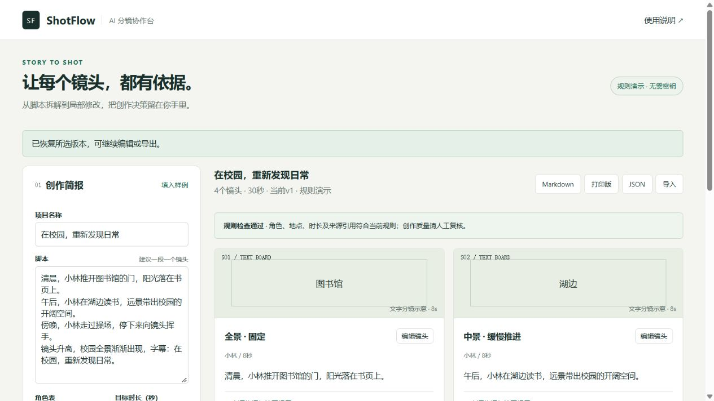

# ShotFlow · AI 分镜协作台

面向校园宣传片和短视频创作者的产品原型：把脚本拆成可编辑镜头，在角色或地点变更前检查影响范围，保存版本并导出分镜。



## 60秒体验

需要Python 3.11或以上；无第三方运行依赖。

```powershell
python server.py --port 8765
```

打开 `http://127.0.0.1:8765`，点击“生成分镜草案”。默认是**规则演示**，不调用模型，不需要密钥。角色从“小林”改为“小周”，查看影响、确认应用，再导出打印版。

## 已实现

- 创作简报：脚本、角色、地点与10—300秒目标时长。
- 文字分镜：景别、运镜、动作、对白、绘图提示及原文片段。
- 逐镜编辑；角色／地点变更先预览、后确认；原始依据保持不变。
- 角色和地点引用、来源片段、总时长与结构检查。
- 保存／恢复最多20个浏览器本地版本；导入、导出JSON；导出Markdown及可打印HTML。
- 可选Chat Completions兼容接口。模型错误会显示，不会自动伪装成演示结果。

当前不生成图片或视频；文字卡片是镜头信息的示意，不是模型生成画面。规则演示按段落拆镜，最多12段，超出会要求合并；没有进行实际用户访谈、线上效果实验或外部模型性能验证。

## 接入真实模型

仅在本地终端设置环境变量，再启动服务。不要将密钥粘入网页、源码或公开仓库。`.env.example`是字段说明，服务**不会自动读取.env文件**。

```powershell
$env:AI_BASE_URL = "https://你的服务地址/v1"
$env:AI_MODEL = "服务支持的模型标识"
$env:AI_API_KEY = "在本机设置你的密钥"
python server.py --port 8765
```

切换“真实模型”。接口须支持 `POST /chat/completions`、`messages`与文本 `choices[0].message.content`。模型需要返回约定JSON，应用再做本地校验。供应商如不支持该协议需调整适配器。当前验证使用本机模拟上游，未证明任何具体外部模型的效果。

服务仅绑定127.0.0.1，适用于个人本地作品演示；不含多人认证、配额或公网生产部署能力。取消等待会终止浏览器等待，不能保证上游停止生成或计费。

## 测试与样例

业务测试使用Node 20+内置测试，无需npm安装。

```powershell
node --test tests/core.test.mjs
python -m unittest discover -s tests -p test_server.py -v
node scripts/export-demo.mjs
```

样例写入 `examples/`。测试口径和实际记录见 [测试报告](product/TEST_REPORT.md)。

## 发布到GitHub与Pages

源码仓库与演示站是两件事：推送代码后，在仓库 **Settings → Pages → Deploy from a branch → main → /docs** 保存。Pages只运行离线演示；Python服务和密钥不在Pages执行。部署完成后，使用GitHub显示的实际网址，勿在简历填猜测链接。

仓库包含GitHub Actions测试工作流，推送及Pull Request会自动运行核心规则、HTTP契约和脚本语法检查。

## 产品材料

- [PRD与验收标准](product/PRD.md)
- [设计取舍与数据流](product/DECISIONS.md)
- [两分钟操作演示](product/DEMO.md)
- [测试与当前限制](product/TEST_REPORT.md)

技术：原生HTML/CSS/JavaScript、浏览器localStorage、Python标准库HTTP代理。为便于学习和部署，没有加入框架、数据库、RAG、多Agent或微调。

开发方式：产品设计与AI辅助原型实现。功能、验证口径及当前边界见源码与产品文档。

参考：[Chat Completions接口文档](https://developers.openai.com/api/reference/resources/chat)、[GitHub Pages官方说明](https://docs.github.com/en/pages/getting-started-with-github-pages/what-is-github-pages)。MIT License。
