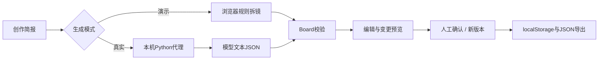

# 设计取舍与代码地图

## 为什么是工作台

产品价值假设在结构和修改过程：角色、地点、镜头与来源形成可编辑记录。模型主要提供草案，用户保留创作判断与确认权。

## 为什么首版没有RAG与多Agent

所需事实由当前简报提供，没有外部知识检索需求。镜头生成、校验、编辑的流程边界明确，先采用固定工作流。添加多Agent会增加调用、状态和调试成本，尚无任务收益证据。

## 规则演示与真实模型

规则演示按换行切镜并分配整数时长，用于体验交互。它不理解电影语言，也不代表模型生成能力。真实模式使用同一Board结构，但必须经过解析、来源和引用检查；两种来源明确标记。

## 人工确认与版本

角色／地点变更采用字段和名称文本匹配，先预览，再确认。它不能识别所有代词、别名或语义依赖；这是未来需要真实样例检验的问题。每次修改建立新的revision，已保存的历史是深拷贝，避免连带修改。

## 数据流

## 阅读顺序

1. `docs/core.mjs`：输入校验、Board、变更预览、导出与模型解析。
2. `docs/app.js`：界面事件、请求、版本快照和下载。
3. `server.py`：环境变量、同源校验、静态目录边界、模型调用与错误处理。
4. `tests/`：用户行为边界和代理契约。

本地存储没有账号、云同步或多人冲突解决；上游请求没有自动重试，避免隐藏重复费用；费用未取得服务定价，不估算数字。
